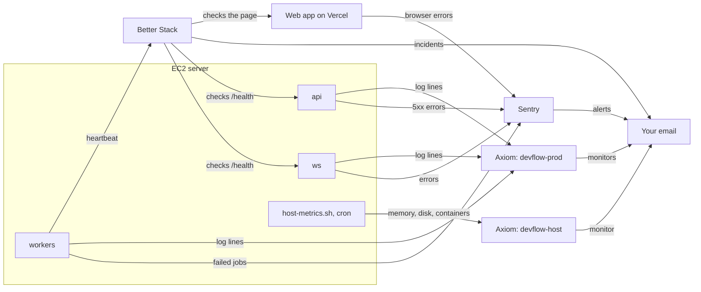

# Monitoring

What watches DevFlow in production, which tool does what, how the pieces connect, and what is still open. When an alert arrives and you need to act, go to `docs/RUNBOOK.md`.

Last updated: 20 November 2026.

## At a glance

| Question | Answered by | How |
| --- | --- | --- |
| Is it up? | **Better Stack** uptime monitors | Checks the API, the ws server and the web app from outside every 3 minutes |
| Are the workers alive? | **Better Stack** heartbeat | The workers ping a secret URL every 2 minutes. Silence opens an incident. |
| What happened, in order? | **Axiom** logs | Every log line of every service, kept 30 days, searchable by request id |
| What broke? | **Sentry** | Unexpected errors with their stack traces, one project per app |
| How is the server? | **Axiom** (`devflow-host`) | A small cron script sends memory, disk and per-container numbers every 2 minutes |
| Which lines belong together? | The **request id** | One id follows a request from the browser through the API into the queue jobs |

All of it is on free plans, with no payment card on any account.

## The tools

| Tool | Plan and limits that matter | Accounts and names |
| --- | --- | --- |
| **Better Stack** | Free. 10 monitors and heartbeats, 1 status page, email and Slack alerts, 3-minute check interval. Password protection, white-labeling and email subscribers are paid, so the status page is public. | Monitors `devflow-api`, `devflow-ws`, `devflow-web`. Heartbeat `devflow-workers`. Alerts by email only. Public status page: https://devflow.betteruptime.com (shows `API` and `Web app` only). |
| **Axiom** | Personal (free). 3 datasets, 500 GB a month of ingest, 25 GB of storage, **30 days** retention, **256 fields per dataset**, 3 monitors, notifiers by email or Discord, US region only. | Datasets `devflow-dev`, `devflow-prod`, `devflow-host`. Notifier `email-me`. |
| **Sentry** | Developer (free). **5,000 errors a month, shared by every project**, 30-day retention. A per-key rate limit is a paid feature, so it is not used. | Projects `devflow-api`, `devflow-ws`, `devflow-workers`, `devflow-web`. |
| **pino** (library) | The logger of the three backend apps | `packages/backend-common/src/logger.ts` |
| **Vercel**, **AWS EC2** | Host the web app and the backend. Their own consoles show deployments and the credits. | |

## How the pieces connect



The uptime checks never touch the database. Neon puts an idle database to sleep after 5 minutes, and a frequent check that woke it would use up the free compute allowance. `/health` answers without a database query.

## The request id

Every API request gets an id. It is how you find all the lines of one action.

1. `requestId.middleware.ts` accepts an incoming `X-Request-Id` (only 8 to 64 safe characters) or makes a new one. It is sent back in the `X-Request-Id` header, and in the `requestId` field of every error response.
2. `request-context.ts` keeps it in `AsyncLocalStorage`, so any code running for that request can read it without a parameter.
3. The logger adds it to every line (`mixin`).
4. `createTracedQueue` copies it onto every queued job. A worker enters the job's context with `runJob`, so the worker's lines carry the same id. A retry keeps the id. A job made outside a request gets `job-<number>`.
5. Sentry events get it as the `requestId` tag.

To follow one request, run this in Axiom:

```
['devflow-prod'] | where requestId == "PASTE_ID" | order by _time asc
```

## What is collected, and what is not

**Logs.** JSON, one object per line. The level is a word (`info`, `warn`, `error`, `fatal`), which Axiom understands. Every line has `service` (`api`, `ws`, `workers`) and, inside a request or a job, `requestId`. Passwords, tokens and authorization headers are redacted. An Error is logged under `err` in a fixed shape (`type`, `message`, `stack`, `code`), so a database error's extra properties cannot add new fields. The list of fields is in `packages/backend-common/AGENTS.md`. Axiom rejects an event that would add a 257th field to a dataset, so keep logging small and flat, and never log a whole object.

**Sentry, backend.** Errors only. Tracing, replay, logs and metrics are off. No user, no cookies, no headers, no request bodies, no query strings. Emails and sign-in tokens inside an error message are replaced with `[email]` and `[token]`. At most 20 events a minute leave a process, and the same error twice in a row is sent once.

**Sentry, web.** The same, plus: breadcrumbs are removed, only the page path is kept (no `?query` or `#hash`), and noise such as `ResizeObserver` and network errors is ignored. At most 20 events a minute leave a browser tab. The web setup is client-only, so server-side render errors of Next.js are not reported separately.

**Which errors reach Sentry.**

| Where | What is reported |
| --- | --- |
| API | Unexpected errors (5xx). Never expected errors (4xx, validation). |
| Workers | The **final** failure of a job, once. BullMQ reports every attempt, so reporting each would triple the events. |
| ws | A Redis event it could not handle |
| api, ws, workers | A crash (`uncaughtException`, `unhandledRejection`), reported by the shutdown helper before the process exits |
| Web | A page that fails to render (`error.tsx`, `global-error.tsx`) and uncaught browser errors |

## What alerts you

Each tool alerts about what it knows best. Every alert goes to email. The last column is for you to tick after testing it (`DEPLOY.md` and the drills below).

| Alert | Tool | Fires when | Tested |
| --- | --- | --- | --- |
| `devflow-api` down | Better Stack | `/health` does not answer, or the answer lacks `"status":"ok"` | [ ] |
| `devflow-ws` down | Better Stack | The same, for the ws server | [ ] |
| `devflow-web` down | Better Stack | The Vercel site does not answer | [ ] |
| Workers heartbeat missed | Better Stack | No ping for 3 minutes plus 3 minutes of grace. The workers ping only while every worker runs **and** the queue's Redis answers. | [ ] |
| New issue | Sentry | A new high-priority issue in any of the four projects. Limited to the `production` environment once that is set. | [ ] |
| Error spike | Axiom (Threshold) | 5 or more `error` or `fatal` lines in a 10-minute window, checked every 5 minutes | [ ] |
| Crash | Axiom (Match) | A line `Uncaught exception` or `Unhandled promise rejection` | [ ] |
| Server low on memory or disk | Axiom (Threshold) | Less than 150 MiB of memory available, or the disk over 85% full | [ ] |
| Budget or credits | AWS | The budget alert | [x] |

Too many alerts teach you to ignore them, so every alert here means "you can act now". Axiom's free plan allows exactly three monitors, and they are used for the three most useful conditions.

## Dashboards (Axiom)

| Dashboard | Dataset | Shows |
| --- | --- | --- |
| `DevFlow (dev)` | `devflow-dev` | Your laptop stack: requests, error rate, latency, failures |
| `DevFlow (prod)` | `devflow-prod` | The live site: requests over time, API error rate, latency (typical and slow), failed requests, which requests fail, worker failures, lines per service and level |
| `DevFlow (host)` | `devflow-host` | The server: memory available, memory and CPU per container, load and swap, disk used, a table of containers right now |

The queries are in `docs/RUNBOOK.md`. A time-series element accepts only `take`, `limit` or `top` after its last `summarize`, which must bin by `_time`, so do arithmetic before the `summarize`.

## Env variables and files

The names only. Real values live in `%USERPROFILE%\prod-env\` on the laptop (never in git), and are copied to the server.

| Where | Monitoring variables |
| --- | --- |
| `api.env`, `ws.env`, `workers.env` (production) | `NODE_ENV=production`, `SERVICE_NAME`, `AXIOM_TOKEN` (one ingest token for `devflow-prod`, the same in all three), `AXIOM_DATASET=devflow-prod`, `SENTRY_DSN` (**different** in each: its own Sentry project) |
| `workers.env` only | `HEARTBEAT_URL` (secret) |
| `host-metrics.env` on the server | `AXIOM_TOKEN` (a **different** ingest token, for `devflow-host`), `AXIOM_DATASET=devflow-host` |
| Vercel, **Production only** | `NEXT_PUBLIC_SENTRY_DSN` and `NEXT_PUBLIC_SENTRY_ENVIRONMENT=production`, both of type **Config**. A `NEXT_PUBLIC_` value is public by design, and a change needs a redeploy. |
| Laptop `.env` files (development) | `SENTRY_DSN`, `NEXT_PUBLIC_SENTRY_DSN` and `HEARTBEAT_URL` stay **empty**. `AXIOM_DATASET=devflow-dev` with its own token keeps the dev logs flowing. |
| Never in production | `LOG_FORMAT` (production is JSON by default), `SENTRY_ENVIRONMENT=development` (it would tag production errors as development), `DIRECT_URL` |
| Not set yet | `SENTRY_AUTH_TOKEN`, `SENTRY_ORG`, `SENTRY_PROJECT` in Vercel. They are only for uploading the web source maps. |

Empty means off: with no DSN, no Sentry code starts, with no Axiom token the logs stay on stdout, and with no heartbeat URL the heartbeat is off. Before a release, run `node scripts/check-prod-env.mjs`. It checks the production env files, and it prints names and PASS or FAIL, never a value.

## Where the code lives

| Piece | Files |
| --- | --- |
| Logger, Axiom stream, request context, error tracking, shutdown | `packages/backend-common/src/` (`logger.ts`, `axiom-stream.ts`, `request-context.ts`, `error-tracking.ts`, `graceful-shutdown.ts`) |
| Request id into queues and workers | `packages/queues/src/` (`traced-queue.ts`, `job-context.ts`) |
| API | `apps/api/src/middlewares/` (`requestId.middleware.ts`, `requestLogger.middleware.ts`, `error.middleware.ts`) and `src/index.ts` (clean shutdown) |
| ws | `apps/ws/src/lib/redis.subscriber.ts` (reports an unhandled event) and `src/index.ts` (clean shutdown) |
| Workers | `apps/workers/src/heartbeat.ts`, the `failed` handlers in `src/workers/`, and `src/index.ts` |
| Web | `apps/web/instrumentation-client.ts`, `lib/sentry-shared.ts`, `app/error.tsx`, `app/global-error.tsx`, `next.config.js` |
| Server | `scripts/host-metrics.sh` (copied to `~/devflow/host-metrics.sh`, run by cron every 2 minutes) |
| Checks | `scripts/check-prod-env.mjs`, `docs/RUNBOOK.md` |

On a stop signal, each backend app closes cleanly, sends the last log lines and errors, and exits. A crash is logged as `fatal`, reported to Sentry, and exits with code 1, so Docker restarts the container.

## Decisions, and what is deliberately not used

- **Three tools, one account each, all free.** Each is best at one question.
- **One Sentry project per app**, with an `environment` tag, not a project per environment. The development DSNs are empty.
- **Logs reach Axiom through `pino.multistream` and the `@axiomhq/js` client**, not the official pino transport, which forces numeric levels that Axiom does not understand.
- **Errors are captured by hand**, with no tracing and no automatic instrumentation. That keeps the memory cost low on a 2 GB server (Sentry adds roughly 50 to 60 MiB per process).
- **Server numbers come from a short cron script**, not an agent or an extra container.
- **A public status page** (https://devflow.betteruptime.com) shows `devflow-api` and `devflow-web` as `API` and `Web app`, with 90 days of history. It is hidden from search engines, and it does not post automatic written updates (the colored bars change by themselves), so a drill or a short blip is not written up in words. It also means an outage is public: when the credits run out, or when the server is stopped on purpose, it shows "down", so **pause the monitors first** when stopping the server on purpose.
- **Not used:** Prometheus and Grafana, OpenTelemetry tracing, Datadog, Sentry's tracing, replay, logs and metrics, Better Stack's own logs and error tracking, and a queue dashboard such as Bull Board (it needs an admin login the API does not have).

## Limits and what happens at the limit

| Tool | Limit | At the limit |
| --- | --- | --- |
| Sentry | 5,000 errors a month, all projects together | Sentry stops recording until the next cycle. It does not charge. |
| Axiom | 256 fields per dataset | An event that would add a new field is rejected, and the logger prints one line to stderr |
| Axiom | 3 monitors | A fourth cannot be created |
| Better Stack | 10 monitors and heartbeats (4 used) | Cannot add more |

If any of them fails, the app keeps working. Sending logs and errors is best effort, and a failure never breaks a request.

## A five-minute weekly check

1. Better Stack: everything Up, and no open incident.
2. Sentry: Stats (usage against 5,000) and the open issues.
3. Axiom: the host dashboard (is memory climbing without levelling off? Is the disk growing?) and the Usage page.
4. AWS: the credit balance.
5. Before stopping the server on purpose, **pause the Better Stack monitors and the heartbeat**, so the stop does not alert and the public status page does not show an outage you caused.

## What is still open

- [ ] Verify every alert fires once (the drills: stop `api`, stop the workers, and the Axiom test values), then tick the table above.
- [ ] Sentry: set the `production` environment on the four alerts, after the first production event.
- [ ] A malformed request body returns **500** and is reported to Sentry. It should be a **400** and not reported. Map `entity.parse.failed` errors in `error.middleware.ts`.
- [ ] Source maps for the web (a Sentry auth token in Vercel as a Secret, plus the organization and project names). Until then, browser stack traces are minified.
- [ ] If `host-metrics.sh` stops, the memory monitor sees no data and stays quiet. Check the host dashboard now and then.
- [ ] Add a health check and an automatic rollback to the CI/CD pipeline (`DEPLOY.md`, section 10) when it exists.