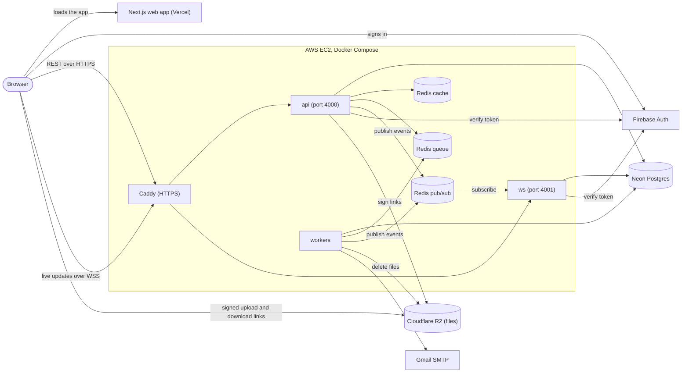
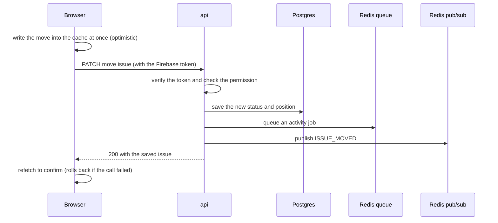
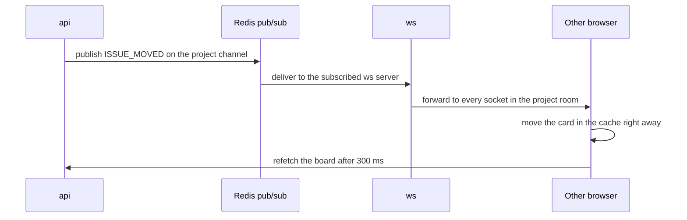
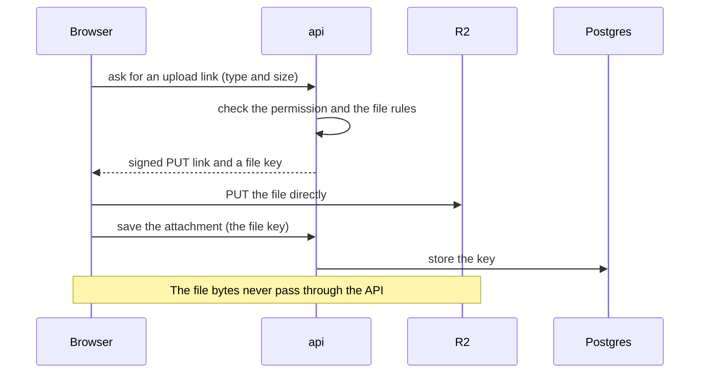
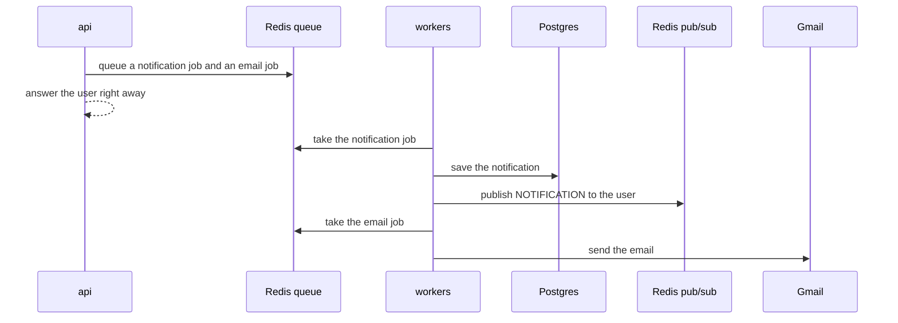

# DevFlow architecture

How the parts fit together, in pictures.

The picture above is the whole system at a glance. The diagrams below are written in Mermaid, which GitHub draws by itself, and they show the same system step by step.

## 1. The system

| Part | Job |
| --- | --- |
| **Web** | Draws the screens. Keeps the data it fetched in React Query's cache. Never decides who may do what. |
| **Caddy** | The only door into the server. Terminates HTTPS and forwards to `api` or `ws`. |
| **api** | The only thing that changes data. Verifies the token, checks the permission, applies the rules, saves, and starts background work. |
| **ws** | Keeps a connection open to each browser and forwards live events. Saves nothing. |
| **workers** | Do the slow work after the API has answered: the activity log, notifications, email and file deletion. |
| **Redis cache** | Short-lived copies of expensive reads (the board). |
| **Redis queue** | The jobs that wait for a worker. It never throws jobs away under memory pressure. |
| **Redis pub/sub** | The line from the API and workers to the ws server. A message that nobody hears is gone. |
| **Postgres** | The one source of truth. |
| **R2** | The files. The browser talks to it directly, with links the API signs. |

## 2. A normal request: moving a card

The card moves on the screen before the server answers. If the call fails, the browser restores a snapshot and shows an error.

## 3. A live update: what the other people see

Two kinds of live events:

| Kind | Examples | Path |
| --- | --- | --- |
| **Saved events** | a card move, a comment, a file, a notification | Started by the API or a worker, and sent through Redis. Works with several ws servers. |
| **Temporary events** | pointers, drag markers, typing hints, who is on the page | Browser to the ws server to the other browsers. Kept in memory, never saved, never through Redis. Works for a single ws server. |

A live message is only a hint. If one is lost, the browser fixes itself with a refetch, and after a reconnect it refreshes once.

## 4. Uploading a file

A private file stores only its key. A fresh signed link is made each time it is read. Deleted files are removed later by a worker.

## 5. A background job: telling someone an issue was assigned

A job can run twice if it is retried, so a worker must be safe to repeat.

## 6. Where it runs

| Piece | Where |
| --- | --- |
| Web | Vercel |
| api, ws, workers, three Redis, Caddy | One AWS EC2 server, in Docker Compose |
| Database | Neon: `devflow-prod` (Sydney) for production, `devflow-dev` (Singapore) for development |
| Files | Cloudflare R2 |
| Sign-in | Firebase |

Releases, rollbacks and the server setup are in `DEPLOY.md`.

## 7. Why it is built this way

| Choice | Reason |
| --- | --- |
| One monorepo with shared types and schemas | The web and the API cannot disagree about the shape of data |
| A queue between the API and slow work | The user does not wait for email or file deletion, and a failed job is retried |
| Redis pub/sub for live events, with a refetch | The API does not need to know which ws server holds a user. A lost message costs nothing. |
| The database as the only truth | Live messages are hints. Nothing breaks if the websocket is down. |
| Direct uploads with signed links | Big files do not pass through the API, and a link names one key, one type and one size |
| Optimistic updates with a rollback | The board feels instant even when the API takes a second |
| Fractional indexing for card order | A drop changes one row, with no renumbering |
| Separate production and development databases | A test mistake cannot damage live data |
| Config from env files, none in the images | The same image runs everywhere, and no secret is baked in |

## 8. Known limits

- Temporary live state (pointers, presence, hints, drag markers) lives in the memory of one ws server. A second instance would need a shared store.
- A member who is removed from a project keeps receiving its live events until their connection drops.
- The production server is a single machine, so there is no failover.

## 9. To add later

- A data-model diagram (an ER diagram of the tables), generated from `packages/db/prisma/schema.prisma`.
- A polished diagram exported from a drawing tool, saved in `docs/images/`, for the top of the README.